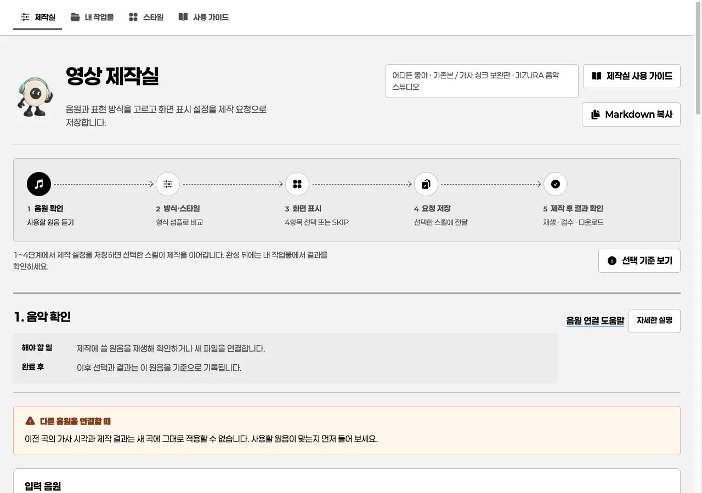
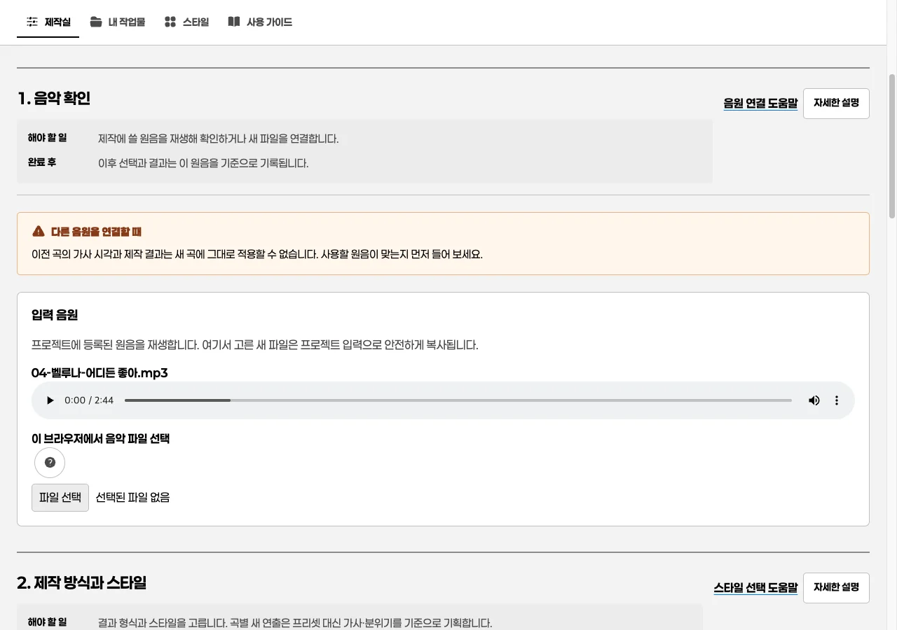
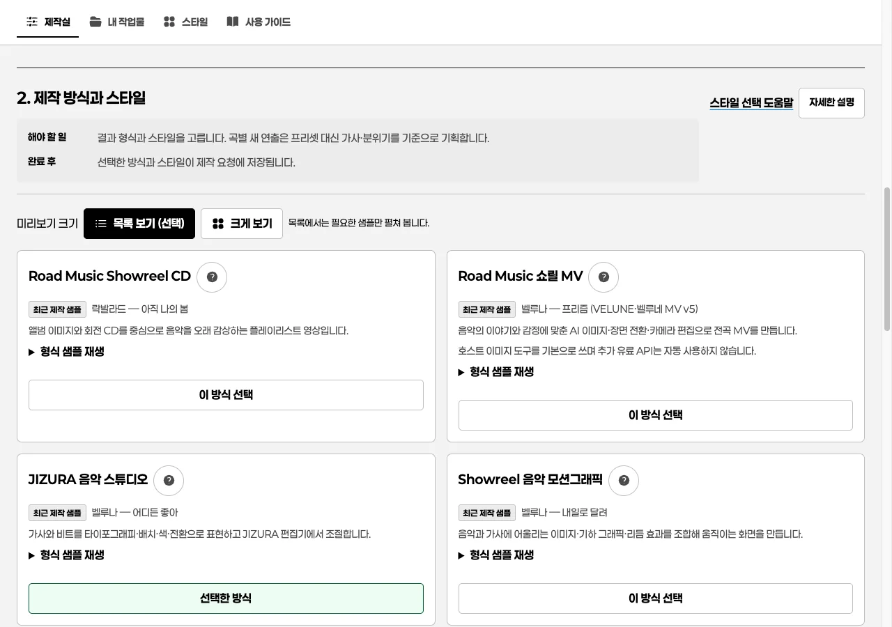
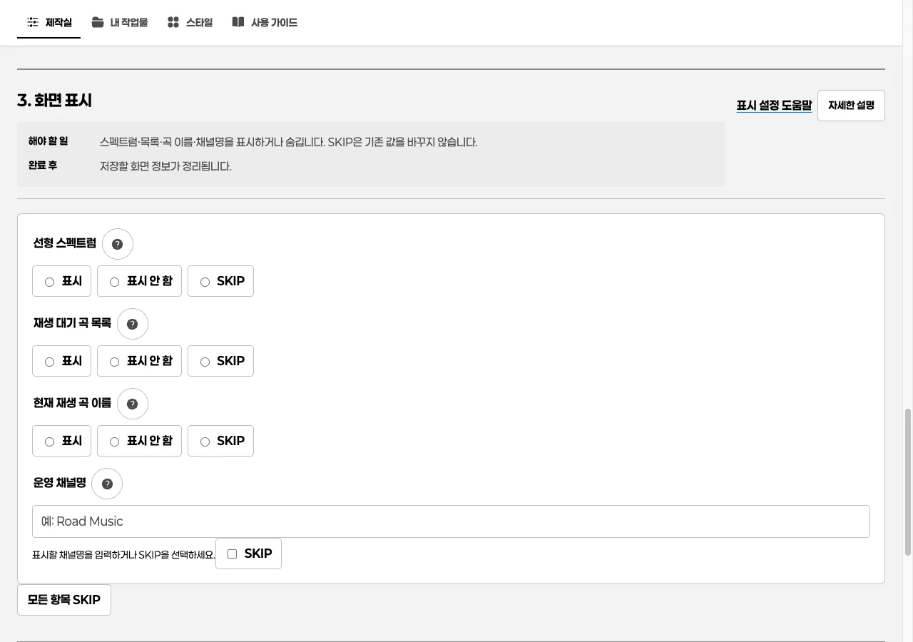
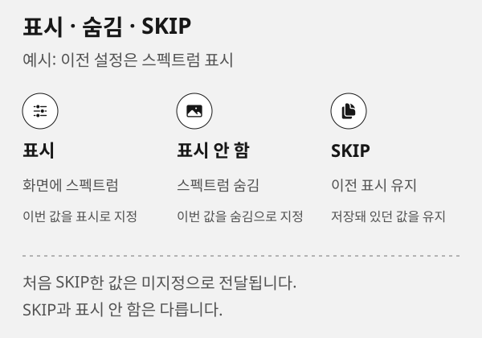
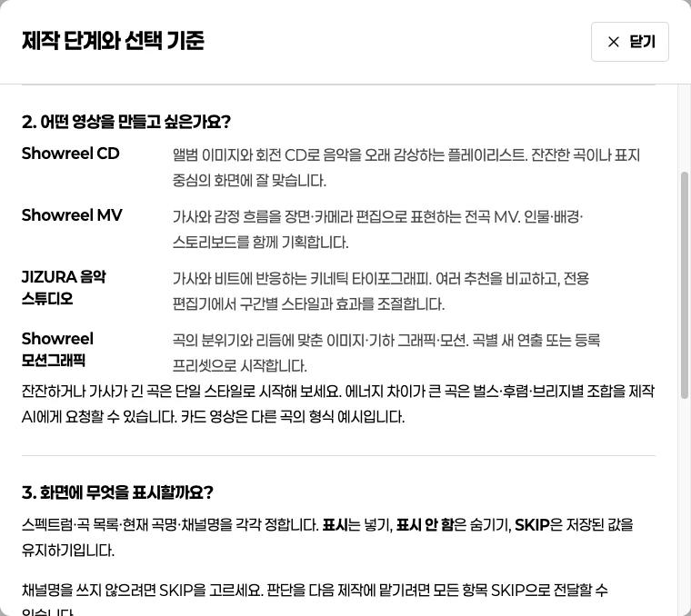
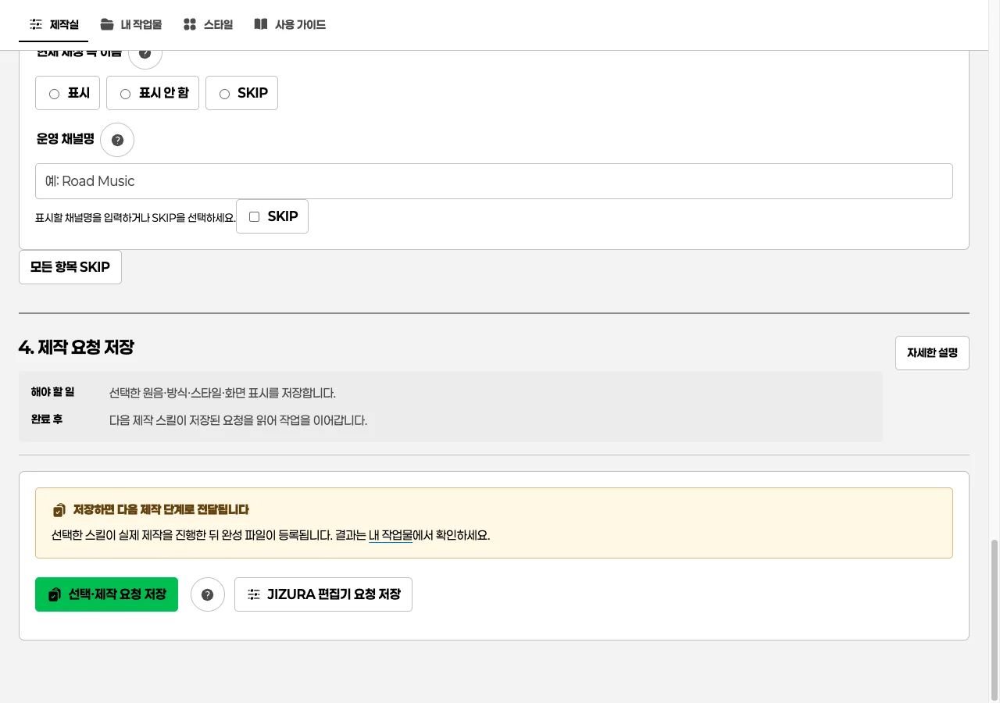
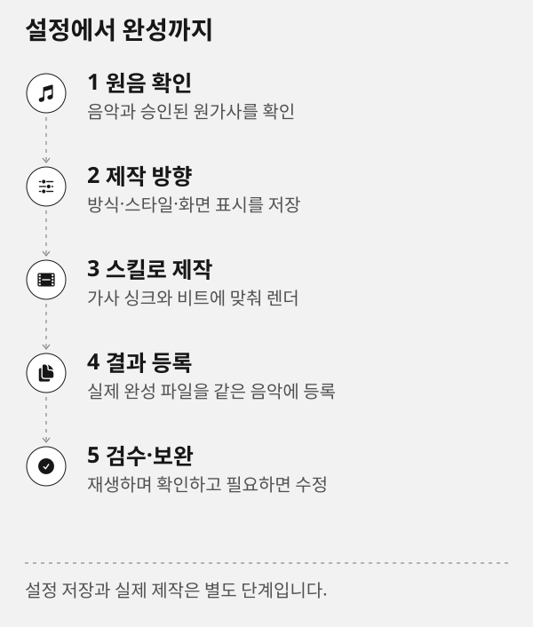

# 제작실: 영상 제작 방향 정하기

제작실 상단의 **CCM 전문 가이드** 버튼에서 ACE·YuE별 CCM 지식과 상세 활용 예시를 바로 엽니다. 기본은 YuE이며 엔진 버튼은 하나씩만 선택합니다.

## 이 페이지의 역할

**제작실**은 한 곡의 영상 제작 방향을 정하는 페이지입니다. 원음을 확인하고, 제작 방식·스타일·화면 표시를 선택해 다음 제작 단계로 전달합니다. 제작 뒤 모든 결과의 재생과 다운로드는 [내 작업물](works.md)에서 합니다.

**선택·제작 요청 저장**은 요청 파일을 저장하는 동작입니다. 현재 Codex 대화에 새 메시지를 자동 전송하지 않으며, 제작 AI가 저장된 요청을 읽어 실제 제작을 이어갑니다.

> [!TIP]
> 처음 불러오기에 실패하면 상단의 오류 안내와 **제작실 다시 불러오기** 버튼을 확인하세요. 이 버튼은 상태를 다시 조회하며 새 제작을 제출하지 않습니다. 등록된 음악이 없는 첫 화면에서도 제작 방식과 스타일을 살펴보고 음원을 연결할 수 있습니다.

## 화면을 읽는 순서



화면에 보이는 곡명·카드·수치는 설명을 위한 예시입니다. 먼저 상단의 프로젝트와 현재 원음이 작업하려는 곡인지 확인한 뒤, 아래 순서대로 선택을 저장합니다.

### 1. 원음과 원가사 확인

상단에는 프로젝트 이름, 제작 방식, 현재 원음 상태가 표시됩니다. 파일을 새로 연결하면 이전 곡의 가사 시각과 결과를 현재 곡의 것으로 간주하지 않습니다. 다른 곡을 선택했다면 가사 싱크와 결과 상태를 다시 검수해야 합니다.

> [!IMPORTANT]
> 원음을 바꾸면 이전 전곡 가사 싱크와 결과 연결을 새 곡에 그대로 적용할 수 없습니다. 새 원음으로 다시 확인하고, 원가사 파일은 화면에서 업로드하는 대신 제작 AI 요청에 함께 지정합니다.



1. 재생 버튼으로 이번에 만들 원음이 맞는지 확인합니다.
2. 원가사가 있으면 제작 요청에 함께 지정할 준비를 하고, 승인한 원문은 바꾸지 않습니다.
3. 다른 음원으로 바꿨다면 이전 가사 시각과 결과를 새 곡에 적용하지 않습니다.

### 2. 제작 방식과 스타일

- **Road Music Showreel CD**: 앨범 이미지와 회전 CD처럼 음악을 오래 감상하는 영상에 맞습니다.
- **Road Music 쇼릴 MV**: 음악의 이야기와 감정 변화에 맞춰 장면을 구성하는 전곡 영상에 맞습니다.
- **JIZURA 음악 스튜디오**: 가사·비트·타이포그래피·색·전환을 중심으로 모션그래픽을 만들 때 사용합니다.
- **Showreel 음악 모션그래픽**: 이미지·기하 그래픽·리듬 효과를 조합하는 화면에 맞습니다.

> [!NOTE]
> 각 카드의 영상은 최근 제작한 **형식 샘플**입니다. 현재 곡의 완성 영상이 아닙니다.



1. 먼저 만들고 싶은 영상의 역할에 맞는 카드 하나를 고릅니다.
2. 같은 단계에서 보이는 프리셋은 형식과 질감을 비교하는 용도입니다. 현재 곡 결과와 혼동하지 않습니다.
3. Showreel 음악 모션그래픽의 **곡별 새 연출**은 프리셋을 강제하지 않는 선택입니다.

등록 프리셋은 화면의 질감과 움직임을 미리 확인하기 위한 선택지입니다. Showreel 음악 모션그래픽의 **곡별 새 연출**은 프리셋 하나를 강제하지 않고 가사와 분위기에 맞춰 새로 기획합니다. JIZURA는 공통 카드 대신 전용 편집기에서 조절합니다.

### 3. 화면 표시

공통 제작실에서는 **스펙트럼·재생 목록·현재 재생 곡·채널명** 네 항목을 정합니다. 표시·표시 안 함 또는 SKIP을 선택하며, 물음표 도움말에서 의미를 확인합니다. 분위기·화면비·해상도·프레임레이트와 효과 강도는 [JIZURA 편집기](jizura.md)의 설정입니다.





1. 각 표시 항목에서 **표시**, **표시 안 함**, **SKIP** 중 하나를 고릅니다.
2. `SKIP`은 기존에 저장한 값이 있으면 유지하며, 처음 SKIP하면 새 값 없이 미지정으로 남습니다.
3. 채널명은 표시할 텍스트를 입력하거나 SKIP을 선택합니다. 빈 채널명을 표시로 저장하지 않습니다.

**자세한 설명** 버튼은 현재 단계의 뜻을 모달로 보여 줍니다. 도움말은 값을 저장하거나 제작을 시작하지 않습니다.



### 4. 제작 요청 저장

필수 표시 항목을 고르거나 **SKIP**을 선택한 뒤 **선택·제작 요청 저장**을 누릅니다. 이 저장은 엔진을 직접 실행하지 않고, 다음 제작 스킬이 읽을 요청만 남깁니다.

> [!NOTE]
> `SKIP`은 기존에 저장된 값이 있으면 보존하고, 처음 선택하면 미지정으로 남깁니다. 이 버튼을 눌러도 이미 만든 영상은 다시 렌더되지 않습니다.



1. 원음·제작 방식·스타일·화면 표시가 의도와 맞는지 다시 확인합니다.
2. **선택·제작 요청 저장**을 누르고 성공 문구에서 다음 제작 단계를 확인합니다.
3. JIZURA를 직접 조절할 작업이라면 **JIZURA 편집기 요청 저장**을 사용합니다.

### 5. 제작 후 내 작업물에서 확인

선택한 제작 스킬이 실제 영상·자막·가사 작업을 마치고 완성 파일을 등록한 뒤에만 **내 작업물**에서 재생과 다운로드가 가능합니다. 설정 저장만으로 결과가 생기지 않습니다.

## Codex에 제작 요청

제작실 상단의 **음원·가사·영상 수정 요청** 입력창에 원하는 변경을 적습니다. 스크롤 중에도 오른쪽 아래 **수정 요청 입력** 버튼으로 작성 중인 내용을 유지한 채 돌아올 수 있습니다. 대상과 검토/제작 방식을 확인한 뒤 **Codex에 요청 보내기**를 누르세요. 대기열 등록은 Codex가 이미 읽었다는 뜻이 아닙니다. 상태가 **Codex가 요청을 수신함**으로 바뀐 뒤에만 수신이 확인된 것입니다. 현재 대화가 작업 중이면 요청은 그 작업이 끝난 뒤 이어 처리됩니다.

입력창에 **초안 저장됨**이 보인 내용은 제작실 서버를 다시 시작해도 같은 프로젝트에서 복원합니다. **초안 저장 실패**일 때는 이 브라우저의 임시 내용은 남지만 서버 복원을 보장하지 않으므로, 저장 상태를 확인한 뒤 다시 저장될 때까지 페이지나 프로젝트를 바꾸지 마세요.

영상 **제작 진행** 요청은 현재 방식·스타일·화면 표시를 먼저 저장하고 최신 프로젝트 버전을 다시 읽습니다. 음악·가사 검토 요청은 화면 표시 네 항목을 새로 요구하지 않습니다. 등록 미디어가 바뀌면 이전 선택을 자동으로 다른 파일에 연결하지 않고 다시 고르도록 안내합니다.

원가사는 읽기 전용으로 보존하고, 새 가사를 입력하면 줄 단위 차이를 참고로 보여 줍니다. 구간 시각은 검토할 위치를 전달하는 정보입니다. YuE가 그 구간만 교체하거나 나머지 원음을 그대로 보존하는 기능은 아닙니다. 악기 보강·후렴 강약·발음 문제는 엔진과 기존 입력을 확인한 뒤 가능한 방법과 한계를 먼저 제안합니다.

응답 시간이 초과되거나 **수신 확인 필요**가 표시되면 자동으로 다시 보내지 마세요. 같은 요청 ID로 **상태 확인**을 사용하고, 내용을 바꿀 때만 **새 요청 작성**으로 새 ID를 만듭니다. 복사가 차단되면 화면의 수동 복사란에서 요청문을 직접 복사할 수 있습니다.

### Codex 대화 이력과 후속 질문

기본 대상인 **대화·질문**은 음원 생성·설치·파일 변경을 지시하지 않는 후속 질문입니다. 입력창의 **답변·대화 이력 보기**를 누르면 저장된 사용자 메시지와 공개 답변 전문으로 이동합니다. **최신 확인**은 저장된 이력을 다시 읽고, 화면이 보이는 동안 약 2.5초마다 같은 내용을 확인합니다. 이는 토큰 실시간 스트리밍이 아니므로 방금 보낸 요청과 답변은 저장 반영 뒤 보일 수 있습니다.

**이전 대화 더 보기**를 누르면 과거 이력을 앞에 이어 붙입니다. 각 메시지는 원문 복사할 수 있고, 복사가 차단되면 전체 원문이 선택된 수동 복사란을 제공합니다. 도구 실행·추론 등 공개 대화가 아닌 내용은 이력에 표시하지 않습니다. 완료된 제작 요청을 다시 열어도 새 메시지는 기본적으로 **대화·질문 · 검토와 제안만**으로 시작하므로 이전 제작 진행 요청을 자동으로 되풀이하지 않습니다.

## 실제 작업 순서

1. 현재 원음과 원가사를 확인합니다.
2. 제작 방식과 프리셋 또는 곡별 새 연출을 함께 고릅니다.
3. 화면 표시 네 항목을 정하거나 SKIP으로 둡니다.
4. **선택·제작 요청 저장**을 누릅니다.
5. 제작이 끝나고 결과가 등록되면 [내 작업물](works.md)에서 같은 원음의 파일과 제작 기록을 확인합니다.

## 예시: 밝은 댄스곡의 제작 방향 저장

예시 곡 **‘새벽의 온도’**가 빠른 후렴과 짧은 가사를 가진 댄스곡이라면, 제작실에서는 `JIZURA 음악 스튜디오`를 고르고 화면 표시를 결정한 뒤 **선택·제작 요청 저장**까지 진행합니다. 이 저장은 영상을 만들지 않고, 다음 제작 단계가 읽을 요청만 남깁니다.



다음 단계에 보낼 요청은 구간별 강약, 원가사 보존, 검수 기준을 함께 적으면 충분합니다.

```prompt
현재 제작실에 저장한 방향을 기준으로 이 음악의 모션그래픽을 제작해 주세요.
벌스는 가사가 읽히는 절제된 움직임으로, 후렴은 비트 반응과 색 전환을 강화해 주세요.
원가사 원문은 바꾸지 말고, 자동 인식과 원문이 다른 부분은 원문을 유지한 채 검수 기록에 남겨 주세요.
완성 뒤 영상과 가사·자막·스토리보드를 같은 음악 결과에 등록해 주세요.
```

## 저장 전에 확인할 세 가지

1. 카드가 가리키는 것은 **형식 샘플**이지 현재 곡의 결과가 아닙니다.
2. `SKIP`은 해당 값을 새로 정하지 않는 선택입니다. 처음 저장하는 항목이라면 미지정으로 남습니다.
3. 저장 후 이미 만든 영상의 색·가사·싱크는 바뀌지 않습니다. 수정은 다음 제작 단계에서 요청합니다.

## 오류와 복구

### 저장 버튼이 동작하지 않아요

필수 화면 표시가 모두 선택되었는지 확인합니다. 값을 정하지 않으려면 각 항목에서 SKIP을 선택합니다. 저장 중에는 같은 요청을 중복 전송하지 않도록 버튼이 잠시 비활성화됩니다.

### 파일 연결에 실패했어요

지원되는 음악 파일인지, 파일을 읽을 수 있는지 확인합니다. 손상된 파일은 기존 원음과 프로젝트 기록을 바꾸지 않습니다. 정상 파일을 다시 고른 뒤 저장 상태가 돌아왔는지 확인하세요.

### 선택을 바꿨는데 화면이 달라지지 않아요

**선택·제작 요청 저장**은 요청 기록만 바꿉니다. 이미 만들어진 영상·가사·싱크는 자동으로 다시 렌더하지 않습니다. 변경을 적용하려면 해당 제작 스킬의 재제작 절차를 진행해야 합니다.

## 자주 묻는 질문

### 프리셋을 여러 개 고를 수 있나요

이 페이지에서는 현재 프로젝트에 적용할 방향 하나를 저장합니다. 여러 스타일 조합이 필요한 JIZURA 작업은 [JIZURA 편집기](jizura.md)에서 구간별 강도를 설계합니다.

### 스타일 샘플을 내려받을 수 있나요

샘플은 비교용입니다. 내려받을 완성 파일은 [내 작업물](works.md)에 등록된 프로젝트 결과만 사용하세요.

## 다음으로 읽기

[스타일 선택 기준](styles.md) · [내 작업물](works.md) · [CLI에서 제작실 열기](cli.md)
