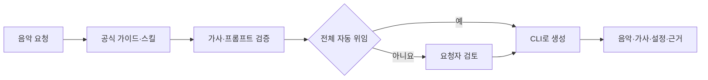

<p align="center">
  <a href="https://github.com/roadkwonai/music-road"></a>
</p>

<a id="road-music"></a>
<h1 align="center">Road Music</h1>

<p align="center"><strong>원하는 음악을 말하면, 로컬 AI와 JSON CLI로 한 곡을 완성합니다.</strong></p>
<p align="center">한국어 가사 · 보컬과 연주곡 · MP3/WAV · 가사 자막 · HTML 모션그래픽 플레이리스트</p>

<p align="center">
  <a href="https://github.com/roadkwonai/music-road/releases/tag/v0.1.0"></a>
  <a href="https://github.com/roadkwonai/music-road/releases/tag/cli-v0.1.1"></a>
  <a href="LICENSE"></a>
  <a href="docs/cli-install.md"></a>
  <a href="docs/ace-prompt-guide.md"></a>
  <a href="docs/getting-started.md"></a>
</p>

<p align="center">
  <a href="#toc-1">AI로 시작</a> · <a href="#toc-2">CLI 빠른 시작</a> · <a href="#toc-3">음악 요청</a> · <a href="docs/README.md">문서 지도</a> · <a href="releases/README.md">릴리스 노트</a> · <a href="https://github.com/roadkwonai/music-road/releases/latest">다운로드</a>
</p>

GUI와 CLI는 같은 엔진·곡 라이브러리·대기열을 공유합니다. Codex·Claude Code처럼 로컬 셸을 사용할 수 있는 AI가 공식 가이드와 동봉 스킬을 참고해 가사·프롬프트를 작성하고 CLI를 실행합니다.

> [!IMPORTANT]
> 기본은 **가사·프롬프트 검토 후 생성**입니다. 가사와 프롬프트까지 모두 자동으로 맡기면 검토를 생략하고, 생성한 음악과 가사·설정·참고 근거를 제공합니다.

<details>
<summary><strong>목차 펼치기</strong></summary>

## 목차

- [AI에게 설치 맡기기](#toc-1)
- [CLI 빠른 시작](#toc-2)
- [AI에서 사용](#toc-3)
- [GUI 실행과 패키징](#toc-4)
- [문서](#toc-5)
- [개발과 라이선스](#toc-6)

</details>

---

<a id="toc-1"></a>

## AI에게 설치 맡기기

지금 설치 상태에 맞는 프롬프트 하나를 복사하세요. **이미 설치된 CLI를 다른 AI에서 쓸 때는 세 번째**를 사용합니다.

| 지금 상태 | 선택할 프롬프트 |
| --- | --- |
| 로드뮤직과 음악 엔진이 없음 | [처음부터 설치](#처음부터-설치하고-음악-생성까지-준비) |
| 앱은 있고 CLI만 필요함 | [CLI만 추가](#로드뮤직이-이미-설치되어-있을-때-cli만-추가) |
| 앱·CLI가 모두 있고 새 AI 세션에서 사용함 | [새 세션 연결](#이미-설치된-cli로-새-ai-세션-시작) |

### 처음부터 설치하고 음악 생성까지 준비

```text
https://github.com/roadkwonai/music-road 의 AGENTS.md와 설치 지침을 따라
로드뮤직 CLI와 엔진·모델까지 설치하고 한국어 음악 생성이 가능하도록 준비해줘.
설치 검증 후에는 내가 요청하는 음악 작업을 이 CLI로 실행해줘.
```

엔진·모델 다운로드에 수 GB의 공간과 시간이 필요합니다. 설치 절차와 지원 범위는 [CLI 설치](docs/cli-install.md)를 따릅니다.

### 로드뮤직이 이미 설치되어 있을 때 CLI만 추가

```text
https://github.com/roadkwonai/music-road 의 AGENTS.md와 설치 지침을 따라
이미 설치된 로드뮤직에 CLI만 추가하고 연결을 확인해줘.
이후 내가 요청하는 음악 작업을 이 CLI로 실행해줘.
```

### 이미 설치된 CLI로 새 AI 세션 시작

설치 경로를 몰라도 **그대로 복사**하세요. AI가 기존 CLI를 찾아 연결하며, 다른 프로젝트에서 연 AI에도 사용할 수 있습니다.

```text
로드뮤직 앱과 CLI는 이미 설치돼 있어. 이 컴퓨터에서 기존 CLI 설치 폴더를 자동으로 찾아줘.
찾은 폴더의 AGENTS.md와 docs/ai-cli.md에 따라 재설치 없이 연결·ACE 준비 상태를 확인해줘.
이후 음악 요청은 동봉 스킬과 공식 가이드로 처리해줘.
```

> [!TIP]
> 새 세션 준비는 **상태 조회까지**입니다. 곡 생성·모델 다운로드·업데이트는 별도 요청을 따릅니다. 자세한 순서는 [새 AI 세션 연결](docs/ai-cli.md#new-session)에 있습니다.

<a id="toc-2"></a>

## CLI 빠른 시작

Node.js 24와 Git이 필요합니다. 음원 변환·영상에는 `ffmpeg`·`ffprobe`, 음악 생성에는 준비된 엔진이 필요합니다.

```bash
git clone --recurse-submodules https://github.com/roadkwonai/music-road.git
cd music-road
npm run setup:cli
node cli/road-music.js schema
node cli/road-music.js setup:check
node cli/road-music.js engines:list
```

`music-road-skills`의 정본은 [별도 공개 저장소](https://github.com/roadkwonai/music-road-skills)에서 관리하고, 이 저장소는 고정 커밋 서브모듈로 참조합니다. `npm run setup:cli`는 CLI 실행에 필요한 Electron까지 `npm ci --include=dev`로 설치한 뒤 동봉된 고정 버전 스킬을 설치합니다. CLI ZIP/npm 배포본에는 실제 스킬 파일이 들어 있으므로 설치한 사용자는 Git이나 서브모듈이 필요하지 않습니다. macOS의 변환 도구는 `brew install ffmpeg`로 준비합니다. 설치된 CLI가 있으면 위 설치를 반복하지 말고 [새 세션 프롬프트](#이미-설치된-cli로-새-ai-세션-시작)를 사용하세요.

| 확인할 것 | 동작 |
| --- | --- |
| `schema` | 현재 버전의 공개 명령·입력값 확인 |
| `setup:check` | 플랫폼 지원 엔진 점검, 미지원 엔진은 `skipped`로 표시 |
| `engines:list` | 설치 여부와 엔진별 준비 상태 확인 |
| 결과 출력 | stdout JSON 한 줄, `--events` 진행 상황은 stderr JSONL |

음악을 만든 뒤에는 동봉된 [music-road-skills](https://github.com/roadkwonai/music-road-skills)의 [공통 HTML 제작실](docs/cli-motion-graphics.md)에서 모션그래픽 작업을 시작할 수 있습니다. 제작실은 `motion:handoff → motion:studio` 흐름으로 CD·리듬 모션·Showreel MV·JIZURA의 실제 4개 샘플 영상을 카드에서 재생해 비교할 수 있습니다.

```bash
node cli/road-music.js motion:handoff --json '{"music":"/absolute/song.mp3","out":"/absolute/new-motion-project","mode":"showreel-motion"}'
node cli/road-music.js motion:studio --json '{"project":"/absolute/new-motion-project","open":true,"timeout":900}' --events
```

음원 없이 먼저 시작하려면 `music`을 생략하고 프로젝트를 만든 뒤 HTML에서 파일을 업로드합니다. 명령 완료 응답의 `nextCommand`는 다음 `motion:studio` 호출을 그대로 제공하므로 AI가 같은 프로젝트에서 이어갈 수 있습니다. 선택·음원 청취·영상·자막 검수는 HTML 스튜디오에서 진행합니다. [음악에서 모션그래픽으로 이어가기](docs/cli-motion-graphics.md)에서 호스트별 설치와 안전 경계를 확인하세요.

첫 서비스 요청은 숨겨진 앱 창을 시작할 수 있습니다. 같은 데이터 폴더의 GUI가 실행 중이면 공유합니다. 전역 `road-music` 명령은 선택적으로 [CLI 폴더에서 연결](docs/cli-install.md#toc-4)합니다. [설치 상세](docs/cli-install.md) · [첫 곡 만들기](docs/quickstart.md)

<a id="toc-3"></a>

## AI에서 사용

CLI 자체에 작사·웹 리서치 AI가 내장된 구조는 아닙니다. AI 에이전트가 [동봉 스킬](skills/road-music-ace/SKILL.md)과 공식 문서를 참고해 입력을 만들고, CLI가 로컬 엔진으로 생성합니다. MCP 서버는 포함하지 않습니다.

**CCM으로 시작하기**

```text
docs/ccm-prompts.md의 C17을 참고해 한국어 여성 모던 워십 1곡을 준비해줘.
76 BPM, 180초, 피아노·어쿠스틱 기타·드럼, 은혜와 동행의 고백으로 해줘.
가사·프롬프트·옵션을 검증해 먼저 보여주고 승인 후 생성해줘.
```

<details>
<summary><strong>CCM 상세 요청 프롬프트 펼치기</strong></summary>

```text
기존 Road Music CLI 설치를 찾아 AGENTS.md와 docs/ccm-prompts.md를 읽어줘.
제목 "주의 손을 따라", 한국어 창작 가사, 따뜻한 여성 리드의 모던 워십 1곡을 준비해줘.
76 BPM, 180초, seed 42, piano·acoustic guitar·drums, strict=false로 해줘.
첫 절은 담백하게, 후렴은 함께 따라 부르기 쉽게, 마지막 후렴은 넓게 펼쳐줘.
가사는 일상에서 받은 은혜→주님의 동행→이웃을 향한 응답으로 전개해줘.
Verse·Chorus·Verse·Chorus·Bridge·Chorus를 실제 한국어 가사로 작성하고,
장르·보컬·공간감은 짧은 style 태그로 옮겨줘. 미지원 전용 옵션은 추가하지 마.
최종 caption 512자·정리 가사 4,096자 이내인지 검증하고 전체 안을 먼저 보여줘.
승인 후 1곡을 생성하고 음원·실제 가사·caption·옵션·참고 근거를 제공해줘.
```

</details>

[CCM 상세 가이드 →](docs/ccm-prompts.md) 과거·최근 근거, **48개 스타일·상세 요청 12개·창작 가사 8편·CLI JSON 8개**에서 복음성가·회중 워십·가스펠·묵상·절기별로 고를 수 있습니다.

**옛 찬송가를 현대 CCM으로 편곡하기**

```text
docs/hymn-remake-guide.md의 H01 가사·NEW BRITAIN 원전과 R01 편곡을 참고해줘.
내가 제공한 가사·프롬프트는 그대로 보존하고, 직접 연주한 참조 음원으로 리메이크 안을 준비해줘.
원전과 한국어 번역·현대 후렴·편곡·녹음의 이용 근거를 나눠 확인해줘.
개선 아이디어는 공식 가이드·장르 문서의 근거와 변경점을 제안만 하고 승인 없이 적용하지 마.
```

[원전 후보 20곡·리메이크 편곡 16가지 →](docs/hymn-remake-guide.md) 원어 가사·고전 선율의 PD 표기와 한국어 번역·현대 음원의 권리는 구분합니다. 앱의 **가이드 보기** 또는 아래 CLI로 읽기 전용 조회할 수 있습니다.

```bash
node cli/road-music.js prompt:knowledge --json '{"topic":"hymn-remake"}'
```

가이드 조회는 앱·엔진을 시작하거나 입력을 바꾸지 않습니다. 사용자 원문을 보존하는 [추천·변경 규칙](docs/music-review.md#preserve-input)을 따릅니다.

**장르별로 요청하기**

```text
한국어 가사로 K-POP·트로트·애절한 락발라드를 각각 1곡씩 만들어줘.
가사·프롬프트·옵션을 먼저 검증해 보여줘.
```

**가사와 프롬프트까지 자동으로 맡기기**

```text
가사와 프롬프트까지 모두 자동으로 정해 한국어 여성 락발라드 1곡을 생성해줘.
완료 후 음악·가사·최종 옵션과 참고 자료·선택 이유도 보여줘.
```

**최근 스타일을 조사해서 만들기**

```text
docs/music-research.md를 따라 최근 인기 있는 AI 플레이리스트 음악을 조사해서
스타일 하나를 고르고 한국어 가사·프롬프트를 작성해 CLI로 1곡 만들어줘.
```

<details>
<summary><strong>AI 요청이 음원이 되는 과정</strong></summary>



이미 승인된 가사·프롬프트를 그대로 생성하라는 요청은 다시 승인받지 않습니다. [검토 규칙](docs/music-review.md)

</details>

| 더 세밀하게 만들려면 | 참고 문서 |
| --- | --- |
| 공식 ACE 가이드에 맞춘 입력 최적화 | [ACE 적용 가이드](docs/ace-prompt-guide.md) |
| Verse·Chorus 등 구간의 의미와 배치 | [가사 태그](docs/lyrics-tags.md) |
| 보컬·악기·BPM·길이·seed·실행 JSON | [음악 생성 옵션](docs/music-options.md) |
| 장르별 간단 요청과 상세 레시피 | [장르별 프롬프트](docs/genre-prompts.md) |
| CCM·워십을 중심으로 제작 | [CCM 48개 스타일·가사·세부 옵션](docs/ccm-prompts.md) |
| 고전 찬송을 현대 CCM으로 리메이크 | [원전·권리·16개 편곡](docs/hymn-remake-guide.md) |

AI가 기존 CLI 설치 폴더를 찾아 그 안의 지침을 읽습니다. 다른 프로젝트의 지침 파일은 덮어쓰지 않습니다. 채팅이 오디오 첨부를 지원하지 않으면 실제 파일 링크로 받습니다.

<a id="toc-4"></a>

## GUI 실행과 패키징

```bash
npm start          # 소스로 GUI 실행
npm run dist:mac   # Apple Silicon용 DMG
npm run dist:cli   # CLI 소스·지침·문서·스킬 ZIP
```

DMG의 앱을 `Applications`로 복사하면 GUI를 사용할 수 있으며 Node.js는 필요하지 않습니다. DMG는 전역 CLI를 설치하지 않습니다. [GUI 설치](docs/getting-started.md) · [패키징](docs/packaging.md)

> [!NOTE]
> 현재 앱은 애드혹 서명이며 Apple 공증을 받지 않았습니다. 실제 검증 환경과 OS별 제한은 [검수 결과](docs/cli-qa-report.md)에 있습니다.

현재 앱 정식 버전은 0.1.0, CLI 정식 버전은 0.1.1입니다. 앱 Release의 Latest가 앱 업데이트 대상이며, CLI는 `cli-v0.1.1` Release와 `RoadMusic-CLI-0.1.1.zip`을 사용합니다. 공통 초기 번호라도 앱과 CLI는 서로의 태그·asset·체크섬·설치 경로를 공유하지 않습니다.

앱과 CLI의 업데이트 방식은 다릅니다. 앱 서비스는 시작 시와 15분마다 앱 Release를 확인합니다. CLI는 AI 세션의 첫 연결에서 한 번 확인하며 상시 감시하지 않습니다.

```bash
# 앱 업데이트
node cli/road-music.js update:check --json '{"manual":true}'
node cli/road-music.js update:install --events --timeout 1800000

# CLI 업데이트 확인과 설치
node cli/road-music.js cli:update:check
node cli/road-music.js cli:update:install --timeout 1800000
```

사용자가 업데이트를 요청하거나 자동 업데이트를 명시적으로 맡긴 경우에만 설치합니다. 앱 설치는 앱을 교체·재시작할 수 있고, CLI 설치는 새 경로에만 설치합니다. 자세한 확인·복구·배포 기준은 [업데이트 가이드](docs/updates.md)를 참고하세요.

> [!NOTE]
> 기존 1.4.x 앱과 이전 공개 CLI 0.1.0 키트는 새 0.1.0보다 숫자가 높거나 같으므로 자동 전환되지 않습니다. 앱 0.1.0 DMG와 새 CLI 0.1.0 ZIP을 각각 새 위치에 한 번 수동 설치한 뒤부터 해당 제품의 0.1.1 이상 업데이트 알림을 받습니다. 이 전환은 설치된 앱·곡·모델·기존 CLI 폴더를 자동으로 변경하지 않습니다.

현재 배포 파일과 실제 설치 결과는 [앱·CLI 0.1.0 초기화 검증](docs/version-reset-qa-report.md)을 참고하세요.

<a id="toc-5"></a>

## 문서

[전체 문서 지도 →](docs/README.md)

| 목적 | 바로가기 |
| --- | --- |
| 설치하고 첫 곡 완성 | [CLI 설치](docs/cli-install.md) · [빠른 시작](docs/quickstart.md) · [GUI 시작](docs/getting-started.md) |
| 다른 AI에서 사용 | [AI 사용·새 세션](docs/ai-cli.md) · [작사 스킬](skills/road-music-ace/SKILL.md) · [검수 역할](prompts/ace-review.md) |
| 음악 다음 HTML 모션그래픽 제작 | [CLI 모션그래픽 연결](docs/cli-motion-graphics.md) · [music-road-skills](https://github.com/roadkwonai/music-road-skills) |
| 음악과 가사 설계 | [ACE 가이드](docs/ace-prompt-guide.md) · [옵션](docs/music-options.md) · [태그](docs/lyrics-tags.md) · [장르](docs/genre-prompts.md) |
| Apple Silicon에서 YuE2로 제작 | [YuE2 Apple Silicon](docs/yue-mlx.md) · [모델별 제작·비교](docs/model-production-guide.md) |
| CCM을 주로 제작 | [CCM 상세 프롬프트·48개 레시피](docs/ccm-prompts.md) |
| 조사·검토·내보내기 | [리서치](docs/music-research.md) · [검토 규칙](docs/music-review.md) · [작업 프롬프트](prompts/cli-workflows.md) |
| 명령과 구현 확인 | [CLI 사용법](docs/cli.md) · [레퍼런스](docs/cli-reference.md) · [프로젝트 안내](docs/project-guide.md) |
| 업데이트·릴리스·검증 | [업데이트](docs/updates.md) · [릴리스 노트](releases/README.md) · [검수 결과](docs/cli-qa-report.md) |

<a id="toc-6"></a>

## 개발과 라이선스

`npm test`로 테스트합니다. 별도 프런트엔드 빌드 단계는 없습니다. `cli/`는 클라이언트, `electron/`는 앱·서비스, `renderer/`는 화면, `python/`는 음악 워커입니다.

ssokMusic Free 1.3.0을 바탕으로 개발했습니다. 원저작자 고지를 포함한 [MIT LICENSE](LICENSE)를 유지합니다. 엔진·모델과 [보관한 공식 문서](docs/vendor/ace-step-1.5/README.md)에는 각각의 라이선스가 적용됩니다. [개발 구조](docs/project-guide.md#코드-구조) · [검증 범위](docs/cli-qa-report.md)
