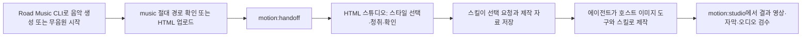

# CLI에서 HTML 모션그래픽으로 이어가기

[Road Music](../README.md) · [CLI 사용법](cli.md) · [모션그래픽 스킬 저장소](https://github.com/roadkwonai/music-road-skills)

Road Music CLI는 음악을 만들고 관리합니다. 완성 음원을 HTML 기반 모션그래픽 스튜디오로 넘기면 스킬이 제공하는 스타일 선택, 음원 청취, 이미지·자막·영상 결과 검수를 한 화면에서 이어갈 수 있습니다.

> [!IMPORTANT]
> 이 연결은 Showreel·JIZURA용 HTML 작업 공간을 준비합니다. LTX 기반 뮤직비디오 감독 스킬·모델은 포함하거나 자동 설치하지 않습니다. 이미지 생성도 CLI 모델 기능이 아니며, 연결한 호스트의 이미지 생성 도구를 사용한 기록만 프로젝트 manifest에 남깁니다.

## 빠른 흐름



## 1. 스킬 설치와 업데이트

`music-road-skills`의 정본은 [별도 공개 저장소](https://github.com/roadkwonai/music-road-skills)에서 관리합니다. Road Music 소스는 고정 커밋 submodule을, CLI ZIP/npm 배포본은 그 고정 버전의 실제 파일을 동봉합니다. 기본 설치 대상은 Codex의 `${CODEX_HOME:-~/.codex}/skills`이며, 이미 수정한 스킬은 백업·상태 결과를 먼저 확인합니다.

```bash
npm run setup:cli
node cli/road-music.js skills:status
node cli/road-music.js skills:check
node cli/road-music.js skills:update --events
```

`skills:watch`은 정해진 시간 동안 새 Release만 알리고 설치하지 않습니다. `skills:update`는 확인된 GitHub Release를 설치합니다.

| 호스트 | 기본 스킬 경로 | 설치 예시 |
| --- | --- | --- |
| Codex | `${CODEX_HOME:-~/.codex}/skills` | `npm run setup:cli` |
| Antigravity App/IDE | `~/.gemini/config/skills` | `npm run setup:cli -- --host antigravity` |
| Antigravity CLI | `~/.gemini/antigravity-cli/skills` | `npm run setup:cli -- --host antigravity-cli` |
| 현재 프로젝트만 | 직접 지정 | `npm run setup:cli -- --skills-target /absolute/project/.agents/skills` |

명시한 `target`은 `host` 기본 경로보다 우선합니다. 이전 `~/.gemini/antigravity/skills` 경로는 자동 이동하지 않습니다.

## 2. 완성 음원에서 HTML 프로젝트 만들기

`out`은 필수 절대 경로이며 아직 존재하지 않는 새 프로젝트 폴더여야 하므로 기존 초안이 덮어써지지 않습니다. `music`은 선택 사항입니다. 생성 완료 음원이 있으면 절대 경로를 넘기고, 아직 음원이 없으면 생략한 뒤 HTML 제작실에서 파일을 업로드할 수 있습니다.

```bash
node cli/road-music.js motion:handoff --json '{
  "music":"/absolute/path/from/songs-list/song.mp3",
  "out":"/absolute/path/new-motion-project",
  "mode":"showreel-motion",
  "host":"codex"
}'
```

```bash
# 음악 없이 화면 구성부터 시작
node cli/road-music.js motion:handoff --json '{"out":"/absolute/path/new-motion-project","mode":"showreel-motion"}'
```

두 호출 모두 성공 JSON의 `nextCommand`에 `motion:studio`의 `project`, `host`, `open:true`가 들어 있습니다. 음악 생성 → 제작실 진입을 자동으로 이어갈 때 이 값을 그대로 사용합니다. 원곡 파일은 이동·변경하지 않습니다.

| 값 | 용도 |
| --- | --- |
| `showreel-cd` | 회전 CD·스펙트럼·플레이리스트 화면 |
| `showreel-mv` | 이미지·리듬 편집 중심 음악 영상 |
| `jizura` | 가사·키네틱 타이포 중심 화면 |
| `showreel-motion` | 장르별 모션그래픽 프리셋과 HTML 검수 |

CD·Showreel 모드에서 선택을 저장하면 `showreel-request.json`도 원자 저장됩니다. 기존 `plan/create --selection` 입력으로 그대로 넘길 수 있으며, MV·JIZURA 모드에는 이를 강제하지 않습니다.

### 제작실의 4개 실제 샘플

공통 HTML 제작실은 아래 네 모드를 실제 16초 샘플 영상으로 비교합니다. 정확한 파일명·출처·오디오 주석은 스킬 저장소의 [샘플 목록](https://github.com/roadkwonai/music-road-skills/blob/main/docs/samples.md)에 고정되어 있으며, 허용 목록 밖의 파일을 HTML에 임의로 노출하지 않습니다.

| 카드 | 샘플 소스 |
| --- | --- |
| Showreel CD | CD 플레이리스트 샘플 |
| Showreel Motion | 리듬 모션 샘플 |
| Showreel MV | Showreel MV 샘플 |
| JIZURA | JIZURA 타이포 샘플 |

제작실의 조작·선택 저장·업로드·검수 화면은 [HTML 제작실 상세 가이드](https://github.com/roadkwonai/music-road-skills/blob/main/docs/html-studio.md)에서 확인합니다.

## 3. HTML 스튜디오에서 선택·청취·검수

```bash
node cli/road-music.js motion:studio --events --json '{
  "project":"/absolute/path/new-motion-project",
  "open":true,
  "review":true,
  "timeout":900,
  "host":"codex"
}'
```

스튜디오는 loopback HTML URL을 stderr JSONL의 `studio-ready` 이벤트로 알립니다. 기본 모드에서는 사용자가 선택을 저장하면 stdout 최종 JSON에 `project`, `selection`, `request`를 반환합니다. `review:true`에서는 선택·피드백 저장 뒤에도 재생을 유지하고 UI의 **검수 마치기**에서만 완료합니다. `selection.json`에는 호스트·모드·SKIP을 포함한 원문 상태가 남습니다. `timeout`은 유한 시간(초)이며, 서버는 영구 백그라운드로 남지 않습니다.

결과를 만든 뒤 `review:true`로 같은 `motion:studio`를 다시 실행하면 재생·피드백을 유지한 채 영상, 음원, 자막, 스토리보드 파일을 HTML에서 확인할 수 있습니다. UI의 **새 결과 확인**은 저장된 manifest를 다시 읽어 반영하고, **검수 마치기**가 최종 완료 JSON을 반환합니다. 프로젝트 manifest에는 실제로 사용한 호스트 이미지 도구와 산출물 경로를 기록합니다.

## 안전 경계

- `skills:*`는 GitHub Release 확인·설치 상태만 다루며 음악 엔진·모델·곡 라이브러리를 설치·이동하지 않습니다.
- `motion:*`는 고정된 `studio.py` 인수만 실행합니다. 임의 셸 코드나 URL은 전달하지 않습니다.
- `motion:handoff`는 선택한 기존 음원을 읽기만 하며, 비어 있는 새 출력 경로만 만듭니다. 음악 없이 시작한 프로젝트는 HTML에서 파일을 업로드합니다.
- 실제 이미지 생성과 영상 렌더는 스킬과 현재 호스트가 제공하는 도구의 역할입니다. CLI가 특정 이미지 모델을 제공하거나 모델 이름을 강제하지 않습니다.

자세한 스타일별 제작 규칙은 [music-road-skills README](https://github.com/roadkwonai/music-road-skills#readme)와 설치된 각 `SKILL.md`를 읽습니다.
