# Road Music 뮤직비디오 하네스

확정 음악에 맞는 전체 연출과 이야기, GPT Image 2.5 API 키시트·샷 이미지, 실제 이미지 스토리보드·원곡 애니매틱부터 LTX 2.5 제작과 검수로 연결하는 프로젝트 스킬이다. 진입점은 [road-music-mv](../.agents/skills/road-music-mv/SKILL.md)다.

새 AI 영상 생성의 기본 모델은 **LTX 2.5 Distilled Q8**이며 [하네스 설정](../.agents/skills/road-music-mv/references/harness-spec.json)의 `generation_defaults`를 따른다. 이는 제작 에이전트의 모델 선택 정책이며 Road Music 앱에 새 LTX 명령을 추가한 것은 아니다. 실제 외부 명령에는 확인한 로컬 2.5 모델을 명시한다. 미설치면 자동 다운로드하거나 2.3으로 대체하지 않는다. 2.3은 사용자 명시 선택과 기존 작업 재현용으로 유지한다. 기본값 변경만으로 2.5가 설치·실행 검증된 것은 아니다.

## 호출

```text
$road-music-mv 이 MV 파일을 모든 프레임 분석해 카메라·촬영·이펙트·전환의 근거를 정리해줘. 생성은 하지 마.
$road-music-mv 내 곡과 이 레퍼런스로 트리트먼트·샷 계획·애니매틱을 설계해줘.
$road-music-mv 이 승인된 샷 계획으로 기본 LTX 2.5 Distilled Q8 MV를 제작해줘. 원곡과 가사는 유지해줘.
$road-music-mv 록발라드에 밴드 라이브와 서사를 섞고 시네마틱한 화면으로 기획해줘. 캐릭터시트·배경·샷 이미지는 GPT Image 2.5 API로 먼저 만들어줘.
$road-music-mv 잔잔한 트로트의 감성 서사형으로, 캐릭터와 배경 이미지 프롬프트까지 기획만 해줘. 실제 생성은 하지 마.
$road-music-mv 이 확정 음원에 맞춰 그룹 인원·연령·미술·카메라·필름룩·효과와 스토리라인을 설계하고 키시트·이미지 스토리보드·애니매틱부터 검수하며 MV를 제작해줘.
```

별도 음악 작업에서 확정한 실제 음원·가사·SHA-256과 영상 경로·제작 조건을 함께 준다. 현재 곡 목록의 첫 곡을 임의로 사용하지 않는다. 이 스킬은 작곡·음악 제작을 위한 후보 청취/평가·10곡 후보 비교·곡 선정을 하지 않는다. 확정 음원의 구간·비트·감정 파악과 완성 MV의 소리/영상 동기 재생 검수는 수행한다. 계획·분석 요청으로 생성·설치·게시를 시작하지 않는다. 이미 맡긴 제작을 같은 내용으로 재승인받지는 않는다.

## 구성

```mermaid
flowchart LR
  I[확정 음원·가사·hash 인계 / 원본 영상] --> A[전 프레임 색인과 실제 검토]
  A --> D[음악별 전체 결정·스토리라인 / Bible·샷·이미지·보드 계획]
  D --> Q[독립 사전 검수]
  Q --> C[GPT Image 2.5 API 인물·의상·배경·소품 키시트]
  C --> CK[독립 키시트 검수]
  CK --> K[GPT Image 2.5 API 단일 샷 이미지·실제 보드 페이지]
  K --> CQ[독립 전체 스토리보드 검수]
  CQ --> P[실제 원곡 애니매틱]
  P --> PQ[독립 재생·길이·싱크 검수]
  PQ --> G[LTX 2.5 어려운 샷 proof·샷 생성·외부 편집]
  G --> V[독립 재생·프레임·오디오 검수]
  V --> O[MV master·제작 기록]
  G --> R[선택: Road Music 배경·시각화 렌더]
  R --> V
```



레퍼런스 분석가, 감독, 이미지 아트디렉터, LTX 제작자, 독립 검수자의 [역할 정의](../.codex/agents/)가 있다. 필요한 역할만 호출한다. 새 역할이 현재 세션에 표시되지 않으면 같은 정의를 읽은 기존 역할로 대체하고 그 사실을 보고한다. 역할 파일 작성과 실제 네이티브 로딩·실행은 별개다.

## 장르와 스타일 선택

음악 장르(발라드·록발라드·트로트 등), 영상 형식(아이돌 퍼포먼스·밴드 라이브·솔로 라이브·서사·혼합), 화면 look(실사·복고 필름·애니메이션 등)을 각각 선택한다. 기획 JSON은 임의 장르·형식도 수용한다. 같은 곡도 선택 조합에 따라 레퍼런스·공연/서사 비중·샷·미술·이미지 목록이 달라진다. 자세한 출발점은 [장르×형식 가이드](../.agents/skills/road-music-mv/references/genre-style-guide.md)에 있다. BLACKPINK·RESCENE·ITZY처럼 사용자가 지정한 K-pop 레퍼런스는 일반 가이드보다 우선한다. 기본안은 인물 매력·멤버별 패션·현실 기반 공간·단체/솔로 퍼포먼스·일상/감성의 조합이며, 몽환은 선택적이다. 우주·비인간 변형·강한 SF는 명시 요청 또는 관찰 근거가 있을 때만 쓴다.

전체 제작에는 **필요 이미지 선행 확보와 독립 검수**가 들어간다. 각 인물의 공통 master→캐릭터시트·의상, 장소 배경→샷별 단일 기준 이미지 순으로 기본 GPT Image 2.5 API를 사용하고, API 키가 없거나 image_gen 선택 시 내장 image_gen을 사용한다. 반복 멤버·의상·장소·시대가 있는 기획은 먼저 Bible을 만들고, 멤버/의상/장소/키프레임 연결을 검사한다. 실제 파일과 해시·검수 기록이 없으면 LTX 단계에 진입하지 않는다. 기획-only는 이미지 프롬프트/목록까지 작성하며 실제 이미지를 생성하지 않는다. 실제 공연 기록과 가상 라이브형 영상은 제작 의도와 기록을 구분한다.

새 이미지 제작 전에는 [음악 맞춤 미술·실사 촬영 지침](../.agents/skills/road-music-mv/references/music-led-lookdev.md)으로 의상·세계 명소/자연/대형 스튜디오·소품·화보 구도를 조사한다. 곡별 선택 이유를 남기고 의상 master→해당 룩의 고정 원문 캐릭터시트, 배경 시점과 소품부터 제작·독립 검수한다. 새 래스터는 기본 GPT Image 2.5 API(`gpt-image-2.5-sunburst`), API 키가 없거나 `image_gen` 선택 시 내장 `image_gen`으로 만들며, 빛·크롭·원근·접촉·피부/직물 재질을 실제 이미지에서 대조한다. 문서 보드의 원본 사진 배치는 로컬 compose로 구분한다.

## 전체 연출과 실제 스토리보드

[전체 연출 계약](../.agents/skills/road-music-mv/references/creative-direction.md)의 `production-design.json`은 음악 구간과 그룹 인원·연령·컨셉·의상/헤어·장소/세트·소품·공연/안무·카메라/렌즈·빛/색·필름룩·VFX·전환·시각 특수효과·음향 정책·그래픽의 선택 이유를 연결한다. 실제 촬영과 AI 생성 look, 유명 실존 장소와 허구 세트, 시각 SFX와 음향 효과를 구분한다. 서사형은 욕구·행동·변화·회수, 퍼포먼스형은 감정/에너지/대형의 변화로 곡 전체의 흐름을 만든다.

`storyboard.json`은 모든 shot의 패널·시점·이미지 ID와 페이지 순서를 정의한다. 실제 패널 이미지는 해당 shot-start/end와 공유하고, 페이지는 승인 패널을 변형하지 않는 로컬 조립으로 만든다. 보드 PNG는 검토용이며 LTX에는 단일 샷 이미지를 사용한다. 새로운 인물마다 키시트를 만든 뒤 필요한 소품과 공간의 상태·지리를 함께 추적한다.

전체 제작의 실행 계획은 13개 노드다. `validate_preproduction.py`의 선택 인자 `--production-design`·`--storyboard`와 `--stage keys|storyboard|animatic`으로 단계별 준비를 검사한다. 키시트와 보드에서는 실제 이미지/페이지와 독립 검수, 애니매틱에서는 실제 원곡 연결 영상·재생 검수 기록까지 필요하다. 구조가 맞는 계획만 있으면 `ready:false`이고, 변조·참조/시간 오류와 단순 미준비를 구분한다. 기존 이미지-only API는 보존한다.

보드 전역 검수는 production-design·image-plan·shot-plan·storyboard의 canonical JSON digest에 결속한다. 실제 파일 SHA, 하네스 입력 fingerprint와 각각 다른 값이다. 음악/스토리/이미지가 바뀌면 영향받은 보드·애니매틱·LTX 샷을 다시 검수한다. 문자열·해시 검사로 좋은 이야기나 얼굴 동일성·실제 음악 싱크를 보증하지 않는다.

키 검수도 같은4문서 digest에 결속한다. 키 단계는 미래 샷 이미지나 보드 파일을 요구하지 않는다. 모든 노드가 소비하는 산출물의 생산자에 직접 의존하도록 해 계획 변경이 실행 지문에서 빠지지 않게 한다. 패널과 페이지는 실제 시간 순서대로 검증한다.

원곡 애니매틱은 무손실 오디오를 유지하는 `preproduction/animatic.mov`를 기본으로 한다. 원본과 내장 오디오를 같은 sample rate/channels의 PCM-s32 신호로 검사해 다른 곡·무음·잘림을 거부한다. 이 파일 검수와 실제 소리/영상 재생 검수를 함께 수행한다. 최종 MV는 기존 MP4 납품을 유지한다.

[revfactory/codex-harness](https://github.com/revfactory/codex-harness)의 `80f8217b5b6d3f220a31f05f9c0adaf09dac40f4`를 프로젝트에 동봉했다. 실제 `create_agent.py`, `run.py`, `validate.py`를 사용한다. 개인 설정·기본 5역할 팀은 설치하지 않았다. 원본 [LICENSE](../.agents/skills/harness/assets/LICENSE)·[NOTICE](../.agents/skills/harness/assets/NOTICE)를 보존했다.

스킬 본체는 `.agents/skills/`에 하나씩 있으며 `.codex/skills/`는 같은 본체를 가리키는 호환 링크다. AGENTS.md에 진입점을 연결했다. 신규 세션에서 스킬·역할을 다시 발견할 수 있다.

## 조사 자료와 분석 상태

[감독 조사](../.agents/skills/road-music-mv/references/director-research.md)는 신우석·VM Project·RIGEND·HIGHQUALITYFISH의 직접 인터뷰를 근거로 감정, 시점, 애니매틱, 공간·빛·색, 편집과 VFX의 판단을 정리했다. 감독의 발언과 이 하네스의 제작 권고를 구분한다.

[초기 코퍼스](../.agents/skills/road-music-mv/references/reference-corpus.json)는 Armageddon, HEYA, Not Like Us, Manchild, Anxiety다. 공식 수상·크레딧을 선정 근거로 삼았으며 현재 인기 순위는 아니다. 정확한 공개일이 상충하거나 확인되지 않으면 미확인으로 남겼다. 작품별 프레임 검토 상태를 확인하고, 메타데이터 조사만 된 작품을 전수 분석 완료라고 인용하지 않는다.

[장르·라이브 비교 후보](../.agents/skills/road-music-mv/references/genre-references.json)에 발라드·록발라드·트로트 계열 9건을 추가했다. Easy On Me·Wind의 MV/라이브 비교, 초혼의 버전별 장르 차이, 나는 반딧불의 2025 상반기 음원 차트 근거 등을 구분한다. 이 목록은 아직 프레임 분석한 결과나 2026년 현재 MV 인기 순위가 아니다.

사용자 지정 BLACKPINK·RESCENE·ITZY의 확장 관찰은 [별도 작품 등록부](../.agents/skills/road-music-mv/references/kpop-mainstream-research.json)와 [제작 적용 지침](../.agents/skills/road-music-mv/references/kpop-mainstream-playbook.md)에 있다. 패션·스타 퍼포먼스, 일상·몽환·감성, 안무·에너지 방향을 선택할 수 있으며 SF는 선택형이다. 작품별 실제 확보 해상도·프레임 범위·원본 확대와 연속 재생 여부를 따로 확인한다.

당시 원본 화질 정정·재확보 검수에서 5편의 공개2160p와 WHISTLE 최고공개1080p를 확보했다. 스킬은2160p 우선·최소 인코딩1080p를 적용하며 업스케일로 기준을 충족한 것으로 처리하지 않는다. 새파일의 전체 디코드·화질 검사와 전수 의미 재분석은 구분한다.

전 프레임 도구는 실제 PTS·SHA-256·모든 썸네일·contact sheet·탐색 HTML을 만든다. 검토 도구는 실제 관찰 범위와 샷 주석의 누락·중복·원본 및 패키지 변조를 검출한다. 이미지 생성이나 의미 판정을 자동 수행하는 도구는 아니다. 구체적인 명령과 필드는 [분석 절차](../.agents/skills/road-music-mv/references/analysis-protocol.md)를 따른다. Armageddon·Manchild의 실제 관찰과 제작 전이는 [표본 분석](../.harness/music-video/pilot-analysis.md)에 별도로 기록했다.

## 로드뮤직과 LTX

현재 Road Music 공개 CLI는 LTX 생성·다중 샷 타임라인 명령을 제공하지 않는다. 설치된 외부 `ltx-2-mlx`와 ffmpeg를 사용해 샷·편집 master를 만들고, 필요한 경우 완성 영상을 공개 배경·렌더 입력으로 연결한다. [버전·옵션과 연결 계약](../.agents/skills/road-music-mv/references/ltx-roadmusic.md)에 실제 확인 범위와 2.3/2.5 구분을 기록했다.

한국어 노래 립싱크·복수 인물 안무·손·악기·인물 일관성은 어려운 구간의 proof로 먼저 검증한다. 실험 기능 노출이나 풍경 샷 성공을 해당 품질의 보장으로 쓰지 않는다.

[그룹·세계관 Bible 계약](../.agents/skills/road-music-mv/references/group-world-planning.md), [이미지 선행 제작 계약](../.agents/skills/road-music-mv/references/image-preproduction.md), [이미지 프롬프트 예시](../.agents/skills/road-music-mv/assets/image-plan.example.json)에 인물·배경·참조 순서와 각 샷의 연결을 기록했다. 예시는 가상 인물의 계획이며 실제 생성 결과가 아니다. 이전 2032/우주 정원 Bible은 과거 제안으로 분류했으며, 2026 현실 기반의 별도 제안도 검수했다. 과거 제안·원시 검수 자료는 2026-10-19 사용자 승인 정리로 제거했으며 새 작업에는 공통 Bible 계약을 적용한다. `validate_mv_context.py`는 Bible 구조와 image/shot binding을, `validate_preproduction.py --bible`는 파일·이미지 형식·참조 계보·해시·검수 기록을 검사한다. 구조 통과만으로 실제 얼굴·공간 동일성이 보장되지는 않으며 별도 시각 비교가 필요하다.

## 검증 범위

구조 검증과 실제 ffmpeg fixture 테스트를 수행한다. 독립 사용 시나리오·코드 검토, 환경·명령 스냅샷과 한계는 [.harness/music-video/](../.harness/music-video/)에 기록한다. 실제 생성·영상 재생·오디오 청취가 없는 검사를 그 성공 근거로 대신하지 않는다. 이전 실행은 덮어쓰지 않고 입력 지문과 의존성으로 부분 재개한다.

장르/형식·이미지 선행 제작 확장의 최신 검증은 [별도 기록](../.harness/music-video/genre-image-verification.md)에 있다. 이미지 게이트17개와 기존 프레임 도구10개, 저장소182개 테스트를 통과했다.
