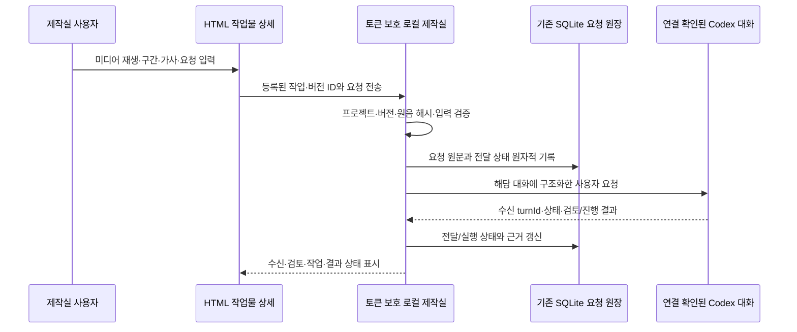

# 제작실 초기 구동 복구와 Codex 수정 요청 연결 설계

작성일: 2026-10-20 KST. 초기 구동 오류 수정 후, 공식 큐의 동일 대화 수신 확인과 사용자 구현 승인을 반영한 설계다. 기존 **선택·제작 요청 저장**과 별도의 **Codex에 요청 보내기**를 구분한다.

연결 시험의 근거는 [동일 대화 연결 검증](studio-codex-connection-qa.md)에 기록했다. 앱 내부 전송과 공식 CLI 대기열 모두 같은 대화 실제 수신에 성공했다. 큐 요청은 현재 응답 종료 뒤 새 턴에서 처리한다. 사용자 요청으로 추가한 [대화 전문·이력](studio-codex-chat-design.md)은 공식 App Server의 읽기 전용 저장 이력 조회를 사용한다. 즉시 steer나 새 turn 실행용 서버 연결은 사용하지 않는다.

## 목표와 완료 기준

CLI를 처음 연결한 사용자도 음원이 없는 제작실을 열 수 있고, 완성 음원을 등록한 뒤에도 음원·제작 방식·스타일이 표시되어야 한다. 내 작업물에서 음악·영상을 재생하고 가사와 문제 구간을 지정해 원래 제작하던 Codex 대화로 요청할 수 있어야 한다. 요청 저장, Codex 수신, 검토, 실제 생성, 완성본 등록은 서로 다른 상태다.

사용자 의도는 악기 추가, 발음·튀는 음의 개선, 후렴 강화, 가사 수정과 영상 보완이다. 구간 밖의 원음 보존이 필요한 경우 이를 별도 조건으로 받는다. YuE가 지원하지 않는 부분 파형 편집을 가능한 기능으로 표시하지 않는다.

## 확인한 현재 구조와 오류

- `publish()`는 완성 파일을 `DeliveryStore.publish()`의 공통 delivery manifest로 정규화한다. 파일 크기는 `bytes`로 저장됐지만 `Session.state()`의 완성 미디어 응답은 `item['size']`를 사용해 `KeyError`가 발생했다. `/api/state` 전체가 실패하므로 실제로 목록이 있어도 초기 HTML 렌더가 실행되지 않았다.
- 저장 형식의 `bytes`와 화면 API의 `size`는 각각 기존 소비자가 있다. 기존 프로젝트를 일괄 변환하지 않고 화면 응답 경계에서 두 형식을 읽는다. 입력 음원, 완성 파일, 재등록·재시작, 미등록 음원을 회귀 검사한다.
- 새 게시에서는 프로젝트 메타데이터의 크기를 `size`로 통일하고, 내부 배포 이력은 기존 `bytes`를 유지한다. 원음과 같은 완성 음원의 별칭도 같은 프로젝트 형식을 사용한다.
- `cli/studio.js`는 기존 서버의 상태를 확인하지만 새 서버는 준비 이벤트만 받은 뒤 브라우저를 열었다. 새 서버도 `/api/state`의 application·project를 검증한 뒤 연다. 실패하면 이번 호출에서 시작한 서버만 정리하고 기존 프로젝트·미디어를 보존한다.
- 세션 파일 등록 뒤 준비 이벤트를 보내고, 준비·상태 확인 실패 시 URL·PID가 이번 서버와 같은 파일만 제거한다. 다른 서버의 최신 연결 정보를 지우지 않는다.
- HTML 초기 상태 조회 실패에는 오류와 재시도 버튼을 표시한다. 재시도는 임시 선택을 유지하고 상태만 다시 읽으며 생성·설치·등록을 재제출하지 않는다.
- `/api/selection`은 설정 파일, `/api/feedback`은 의견을 저장한다. `/api/production/request`는 SQLite 요청 기록이다. 모두 Codex 대화에 메시지를 전송하는 기능은 아니다.

## Codex 연결 가능성과 선택

공식 [Codex App Server](https://developers.openai.com/codex/app-server)는 기존 대화의 `thread/read`, `thread/resume`, `turn/start`, `turn/steer`와 상태 이벤트를 제공한다. 같은 대화의 이력 재개와 지금 실행 중인 대화에 요청을 추가하는 것은 다르므로, **그 대화를 소유한 실행 서버에 연결됨을 먼저 확인**해야 한다.

| 접근 | 장점 | 제약·선택 |
| --- | --- | --- |
| 기존 Codex 소유 서버의 지원되는 로컬 제어 연결 | 같은 대화와 진행 상태를 연결할 수 있음 | 향후 즉시 제어용. 현재 외부 endpoint가 미확인이므로 이번에는 사용하지 않음 |
| 독립 `codex exec resume` 프로세스 | 저장된 대화 이력을 재사용할 수 있음 | 실행 중인 데스크톱 대화와의 동시 제어를 보장하지 않아 자동 대체하지 않음 |
| 공식 `codex queue` | 기존 대화 UUID에 텍스트 대기열 제출 가능 | **채택.** 같은 대화 다음 턴 실제 수신을 확인했으며 `현재 작업 후 진행`으로 사용 |
| 요청 원문 복사 | 연결이 없어도 요청을 잃지 않음 | 복구 경로. 전송·실행 완료로 표시하지 않음 |

이 환경에서 확인한 전역 Codex CLI는 `0.163.0`, 앱의 실행 파일은 `0.163.0-alpha.10.2`이며 `app-server proxy --sock`와 `queue`를 지원한다. 그러나 `codex app-server daemon version`은 기본 제어 소켓 부재로 실패했다. **현재 데스크톱 대화에 연결되는 외부 endpoint는 미확인**이다. 이 결과만으로 데스크톱의 모든 연동 방식이 불가능하다고 단정하지 않으며, 데몬을 새로 띄우거나 독립 프로세스로 같은 대화를 동시에 resume하지 않는다.

이번 구현은 실제 수신을 확인한 큐 경로를 사용한다. 로컬 CLI에서 현재 대화를 프로젝트에 연결하고, 수신한 대화가 공개 CLI ACK를 기록한다. 향후 App Server 직접 연결을 추가한다면 `initialize` → `initialized` → 대상 대화 읽기·소유 확인이 선행돼야 한다. 브라우저가 Codex의 내부 DB·대화 파일·소켓 경로를 직접 탐색하지 않는다.

## 화면 흐름

기존 `/`, `/works/`, `/works/<sha>/`와 상세의 6개 내부 메뉴를 유지한다. 새 전역 메뉴를 만들지 않는다. Paperlogy·DESIGN.md의 공통 폼·상태·버튼을 재사용한다.

1. **제작 설정**: 기존 설정 저장을 유지하고, 연결 완료 시 `Codex에 제작 요청`을 제공한다. 저장과 전송은 구분한다. 연결이 없으면 저장된 요청과 복사 복구를 제공한다.
2. **음악 상세**: 실제 재생 중인 음원·영상의 버전과 파일을 고정하고 `이 작업 수정 요청`을 펼친다. 음악·가사·영상 중 요청 대상을 선택한다.
3. **구간 지정**: 플레이어의 현재 시각을 시작·끝으로 기록하거나 직접 입력한다. 명칭은 `검토할 구간`이다. 유효한 미디어 길이 안에서 시작 < 끝을 검증한다. 시각 미지정 전곡 요청도 허용한다.
4. **내용 입력**: 자유 요청, 보존 조건, 선택적 수정 가사와 원문 대비 변경을 표시한다. 원가사는 읽기 전용으로 보존하고 수정 가사는 새 초안으로 둔다. 페이지 이동·전송 오류 뒤 입력을 복구한다.
5. **요청 의사**: `가능 여부·방법 검토`와 `지정 수정 후 제작`을 구분한다. 새 전체 녹음이 필요한 요청에는 그 영향을 전송 전에 표시한다. 사용자가 구체적으로 승인한 수정·생성은 같은 내용으로 다시 승인받지 않는다. 지정한 구간만 변경하라는 요청을 전곡 재생성 승인으로 확대하지 않는다.
6. **결과**: 원본과 새 버전을 나란히 재생하고 원가사·수정 가사, 실제 변경·검수 근거를 확인한다. 가사 텍스트 저장만으로 가창 변경 완료를 표시하지 않는다.

## 데이터와 요청 전달

기존 `production_prompts`를 원문 요청의 기준으로 재사용하고, 전달 관련 필드는 같은 프로필 SQLite의 별도 연계 테이블에 둔다. 새로운 원장 파일이나 미디어 사본을 만들지 않는다. 원장 마이그레이션은 버전 검사·트랜잭션과 기존 DB 회귀 검증을 갖춘다.

요청에 필요한 값은 requestId, 등록 projectId·groupId, baseVersionId·mediaId·해시, 요청 대상, 원문 프롬프트, 선택적 구간·수정 가사, 보존 조건, 검토/제작 의사다. 엔진은 원래 곡의 메타데이터에서 확인한다. 가져온 파일처럼 엔진·생성 입력이 없으면 자동으로 YuE를 지정하거나 없는 ABC를 가정하지 않는다.

Codex 연결의 threadId·endpoint는 로컬 연결 설정에서만 결정한다. 페이지에서 임의 threadId·절대 경로·셸 명령을 받아 실행하지 않는다. 원문 프롬프트는 코드가 아닌 사용자 요청 텍스트로 전달한다. 서버는 등록된 미디어와 음악 디렉터리를 공개 목록 응답에서 확인한 실제 경로로 해석한다.

공개 Road Music CLI에는 가칭 `studio:agent:status`, `studio:agent:bind`, `studio:request:submit`, `studio:request:status`를 카탈로그·schema와 함께 추가한다. 이름은 구현 시 기존 카탈로그와 최종 확정한다. 브라우저와 에이전트가 내부 IPC나 임의 Python·JavaScript로 기능을 우회하지 않도록 같은 요청 서비스를 사용한다. Codex는 음악·영상 실행에 기존 공개 Road Music 명령만 호출한다.

## 전달 상태와 실패 처리

- 상태: `saved` → `sending` → `accepted` → `reviewing`/`running` → `needs-user-input`/`succeeded`/`failed`. 대기열 경로는 `sending` 뒤 `queued`를 거치고 실제 수신 ACK 뒤에만 `accepted`로 전환한다. 응답 유실은 `uncertain`으로 별도 표시한다. `accepted`는 Codex 수신 증거이며 음원 완성이 아니다.
- requestId와 입력 지문으로 중복 클릭을 한 번만 처리한다. 같은 ID의 다른 본문은 거부한다. 서버 재시작 후에도 이전 요청 상태를 조회한다.
- 요청 전송 직후 응답이 유실되면 자동 재전송하지 않는다. 알려진 turnId·Codex 이력·상태로 수신 여부를 확인한 뒤 다음 행동을 정한다. 확인할 수 없으면 원문과 `수신 확인 필요`를 보존한다.
- 이번 큐 경로는 현재 작업 후 같은 대화의 새 턴으로 처리한다. 다른 작업을 interrupt하거나 별도 `exec resume`을 실행하지 않는다.
- 향후 즉시 제어 경로를 추가하면 활성 턴에 일치하는 `expectedTurnId`로 `turn/steer`를 사용하고, 닫힌 대화는 같은 소유 서버에서만 `thread/resume`한다. 새 대화로 조용히 바꾸지 않는다.
- 토큰·Host·Origin·본문 크기·미디어 접근 검증을 기존 HTTP 핸들러에 유지한다. 연결 비밀값은 HTML·URL·제작 기록·Release에 넣지 않는다. 승인·인증 요청을 임의 허용하거나 기존 권한 설정을 완화하지 않는다.
- 전송 중 입력과 버튼 상태를 보존하고 결과는 가까운 상태 영역에 표시한다. 연결 해제는 다른 제작·렌더 작업을 종료하지 않는다.

## YuE 요청별 가능 범위

공식 고정판 `yue2-v0.1.6`과 현재 Road Music의 `yue-mlx` 계약을 기준으로 한다. 공식 입력에는 waveform inpainting, 편집 시간 구간, phonemes, 참조 가수 필드가 없다. 시각 지정은 **진단·검수 위치**이며 그 부분만 합성한다는 의미가 아니다. [공식 편집 문서](https://github.com/multimodal-art-projection/YuE/blob/9c6c4b349be978b06a9d0d958471a07a6cdeff4d/docs/editing.md), [공식 입력 계약](https://github.com/multimodal-art-projection/YuE/blob/9c6c4b349be978b06a9d0d958471a07a6cdeff4d/skills/yue2-music/references/generation-and-covers.md)

| 요청 | 처리 경로 | 설명할 한계 |
| --- | --- | --- |
| 악기 추가·후렴 비트 강화 | style 또는 parts 편성·강약 변경, 새 prepare → generate | 편성 의도이며 독립 stem 믹서가 아니다. 새 전체 녹음과 타 구간 변화 가능 |
| 가사 바꿔 다시 노래하기 | 수정한 전체 입력으로 새 prepare → generate | 기존 선율 보존 의사에 따라 ABC 선택. 같은 가수·타 구간 파형 보장 없음 |
| 악보의 음정·리듬·화음 수정 | ABC 사본 수정 → score 검사·비교 → song:render | 기존 lyrics/style 유지. 국소 악보 변경이 국소 파형 보존을 뜻하지 않음 |
| 발음 한두 음절·튀는 음 | 입력·실제 청취·기술 원인·이전 시도를 확인한 뒤 방법 제안 | 음소 단위 강제 교정 미지원. 자동 전곡 재생성 반복을 기본으로 하지 않음 |
| 표시 가사 정정 | song:lyrics 및 가사 파일의 별도 새 버전 관리 | metadata 저장만으로 음원·가창·생성 입력이 바뀌지 않음 |
| 합성·디코더 기술 비교 | yue:capabilities 허용 범위의 song:replay | 가사·편곡·ABC를 바꾸는 수단이 아님 |
| 구간 밖 원음을 완전히 보존 | 현재 YuE 생성 경로에서는 실행 불가로 안내 | 별도 오디오 편집 방법을 제안하되 현재 공개 CLI 지원으로 표시하지 않음 |

실행 조회 기준 `yue` replay는 비어 있고 `yue-mlx`는 plan/synthesize/decode를 지원한다. synthesize의 advanced 변경은 odeSteps만, decode는 advanced 변경이 없다. `song:render`는 dir·abc가 필수이고 lyrics/style 필드는 없다. `song:resume`은 원래 요청의 재개에 사용한다. MLX 원문에 있는 realaudio reconstruct·cover를 Road Music의 발음·악기 부분 수정 기능으로 확대하지 않는다.

## Codex로 보낼 작업 지침

요청마다 다음을 포함한다. 이 지침 자체가 새 곡 생성 승인은 아니다.

1. 해당 작업의 AGENTS.md, `skills/road-music/SKILL.md`, `docs/yue-prompt-guide.md`, `docs/vendor/yue2/README.md`와 고정 공식 `yue2-music/SKILL.md`의 관련 편집 절을 읽는다. 버전·현재 schema와 capabilities를 먼저 대조한다.
2. 등록된 음악·버전·엔진·가사·ABC와 요청 원문·변경 범위·보존 조건을 확인한다. 원음과 나머지 승인 원문을 유지한다.
3. 가사 전달, 한국어 자연스러움, 악보 제약, 발음 미세 교정의 재시도 가치를 검토한다. 지원되지 않는 조합이면 가능한 방법 하나와 한계를 제안한다.
4. 검토만 요청했다면 입력·방법 제안에서 멈춘다. 구체적 제작 승인 범위가 확인되면 공개 prepare/score 검사 후 필요한 생성·렌더만 제출하고 job:wait으로 완료를 확인한다.
5. 원본·안정 후보·진행 중 잠금·감사 이력을 보존하고 새 버전 경로에 저장한다. storage와 production-records 스킬을 적용한다.
6. 결과 파일·길이·원문/수정문·실제 입력·구간 및 전곡 회귀 근거를 기록한다. 자동 전사와 직접 청취 여부를 분리한다. 새 생성의 구간 시각은 새 음원에서 다시 찾는다.
7. 최종 음원·원가사·영상은 같은 음악 상세에 연결하고 등록 전 dry-run·재생·다운로드를 검증한다. 새 원음 해시가 생기면 이전 음악과의 버전 관계를 명시하고 기존 원음의 완료본인 것처럼 해시를 바꾸지 않는다.

## 구현 순서와 수용 검사

1. **초기 구동 수정**: bytes/size 호환, 빈 프로젝트·완성 파일 publish 후 재시작, 신규 서버 건강 검사, HTML 오류·재시도 복구. 원본 파일 무변경 확인.
2. **연결 검증**: 지원 endpoint에서 같은 대화 소유를 확인. 읽기 전용 연결 검사 후 격리 대화에서 수신 이벤트 시험. endpoint가 없는 이 환경에서는 차단 상태를 명시한다.
3. **요청 계약**: 카탈로그·schema·CLI와 SQLite 전달 상태를 함께 구현. 중복 클릭·원장 충돌·전송 응답 유실·서버 재시작·잘못된 프로젝트·오래된 원음 해시를 검사한다.
4. **화면 연결**: 제작 설정의 전송 행동과 상세의 재생·구간·가사 편집·복사 복구를 구현. 320px, 키보드, Paperlogy 실제 로딩, 페이지 왕복 초안 보존을 Ego에서 검수한다.
5. **실제 연결 검사**: 유휴 대화 수신, 활성 대화 steer/대기, 없는 대화·연결 해제·승인 필요를 시험한다. 단순 저장을 실제 Codex 수신으로 간주하지 않는다.
6. **음악 검증**: 사용자가 승인한 작은 수정 한 건으로 새 버전과 원본을 비교한다. 실제 생성은 별도 승인된 요청으로만 하며 본 설계 검증 때문에 개인 음원을 재생성하지 않는다.

## 비목표와 남은 검증

이번 작업은 엔진·모델 설치, 기존 GUI/렌더 중단, 배포 Release 변경을 포함하지 않는다. 요청 송신은 같은 대화의 다음 턴 처리이며, 대화 전문 조회에는 별도의 읽기 전용 App Server reader를 사용한다. 즉시 입력 추가·토큰 스트리밍은 이 구성의 보장 범위가 아니다. YuE의 임의 부분 파형 교정, 음색 고정, 청취 품질 개선은 본 설계만으로 보장할 수 없다. 현재 대화 확장의 음악·가사 요청 검증은 실제 생성 없는 모의 실행으로 한다.
