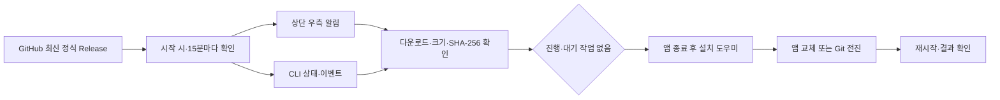

# GitHub Release 업데이트

업데이트 기준은 [roadkwonai/music-road의 최신 정식 Release](https://github.com/roadkwonai/music-road/releases/latest)다. 앱 버전은 `package.json`을 사용한다. 초안·사전 공개 버전은 설치하지 않으며 현재보다 높은 버전만 제안한다.

## 목차

- [처음 설치하거나 1.3.1에서 올리기](#toc-1)
- [앱에서 업데이트](#toc-2)
- [AI 또는 CLI에서 업데이트](#toc-3)
- [동작과 검증 경계](#toc-4)
- [새 버전 배포](#toc-5)

<a id="toc-1"></a>

## 처음 설치하거나 1.3.1에서 올리기

1.3.1까지는 웹사이트 안내 방식이므로 **최초 1회 1.4.0 이상의 DMG를 받아 Applications의 앱을 교체**한다. Git으로 설치한 CLI는 작업 없는 상태에서 `git pull --ff-only`와 `npm ci --include=dev` 후 서비스를 재시작한다. 기존 곡·엔진·설정은 앱 번들이나 저장소 밖에 있으므로 유지된다.

<a id="toc-2"></a>

## 앱에서 업데이트

앱 또는 숨겨진 CLI 서비스가 실행 중이면 시작 시와 15분마다 GitHub에 버전을 확인한다. 새 버전이 발견되면 우측 상단의 업데이트 버튼으로 알린다. 프로그램 정보의 업데이트 확인은 수동으로 다시 조회한다. 앱이 꺼져 있거나 인터넷이 끊긴 동안에는 확인할 수 없다.

업데이트 버튼을 누르면 버전과 변경 내용을 보고 다운로드·설치를 실행할 수 있다. 생성·대기 중인 곡, 엔진 설치, 영상 렌더, 녹음 등 진행 작업이 있으면 설치하지 않는다. 작업을 끝낸 뒤 다시 누른다. 다운로드는 작업 중에도 가능하지만 설치 시점에는 다시 상태를 확인한다.

현재 자동 교체 대상은 **쓰기 가능한 로컬 폴더에 설치한 macOS Apple Silicon 앱**이다. DMG를 마운트한 `/Volumes`에서 실행 중이면 Applications로 먼저 복사한다. 지원되는 파일이 없는 OS·아키텍처는 이유를 표시한다. Windows Store 설치는 Store 업데이트를 사용한다.

<a id="toc-3"></a>

## AI 또는 CLI에서 업데이트

AI에게 다음 프롬프트를 전달한다. 기존에 사용한 설치 폴더에서 실행해야 한다.

```text
로드 뮤직의 AGENTS.md와 docs/updates.md를 읽고 GitHub 최신 정식 버전을 확인해줘.
진행 작업과 대기열을 먼저 확인하고, 작업이 없으면 update:install로 업데이트해줘.
작업이 있으면 취소하지 말고 알려줘. 설치가 예약됐다는 응답과 실제 설치 완료를 구분하고,
service:status --no-start로 서비스의 재시작을 기다린 뒤
update:status와 app:state --no-start로 버전과 결과를 확인해줘.
```

```bash
node cli/road-music.js update:status
node cli/road-music.js update:check --json '{"manual":true}'
node cli/road-music.js update:watch --events --json '{"timeoutMs":60000}' --timeout 65000
node cli/road-music.js update:download --events --timeout 1800000
node cli/road-music.js update:install --events --timeout 1800000
```

`update:install`은 필요한 다운로드도 수행하므로 다운로드 명령은 생략할 수 있다. 설치 인계 후 앱·서비스가 종료되고 다시 시작한다. `installing` 응답은 설치 완료가 아니다. `service:status --no-start`로 재시작을 기다린 뒤 `update:status --no-start`와 `app:state --no-start`로 완료 여부를 확인한다. 설치 도중 서비스를 자동 시작하거나 연결 오류만 보고 설치를 중복 요청하지 않는다.

`update:watch`는 이미 새 버전이 있으면 즉시 반환하고, 없으면 알림 또는 지정한 시간까지 대기한다. `timeoutMs`는 1~3,600,000ms이며 기본은 1시간이다. 제한 시간 안에 변화가 없으면 `timedOut: true`를 반환한다. 자동 확인 주기는 15분이므로 위 1분 예시는 주로 대기·연결 확인에 쓴다. `--events`의 `update:status` 이벤트로 진행 상태를 읽을 수 있다. 서비스를 종료하면 추적도 멈춘다.

Git 설치의 자동 업데이트는 macOS·Linux의 공식 원격 저장소와 수정 없는 작업 폴더에서 정식 버전 태그로 전진할 수 있을 때만 수행한다. Windows 소스 설치는 자동 교체를 지원하지 않으며, 작업을 마친 뒤 수동으로 `git pull --ff-only`와 `npm ci --include=dev`를 실행하고 재시작한다. 로컬 수정·출처가 다른 저장소·이력 분기가 있으면 덮어쓰지 않고 중단한다. ZIP 키트는 Git 이력이 없으므로 자동 소스 교체 대신 Git 설치로 이전한다. 모델을 다시 설치할 필요는 없다. CLI가 공유 중인 서비스가 다른 설치본에서 실행됐다면 그 서비스의 앱이 업데이트 대상이다. `service:status`와 `update:status`로 대상부터 확인한다. 실제 자동 설치 검증은 macOS에서 수행했으며 Linux 실행은 검증하지 않았다.

<a id="toc-4"></a>

## 동작과 검증 경계



확인 API는 `https://api.github.com/repos/roadkwonai/music-road/releases/latest`다. 조회에 사용자 토큰이 필요하지 않다. 설치 파일은 해당 저장소의 Release asset과 GitHub의 다운로드 CDN에서만 받으며 파일 크기와 `SHA256SUMS.txt`의 해시를 비교한다. 임의 URL이나 CLI 입력으로 다른 설치 파일을 실행할 수 없다.

macOS 설치 도우미는 새 번들의 앱 ID·버전·코드 서명을 확인하고 같은 볼륨의 임시 폴더에 복사한 뒤 교체한다. 기존 앱은 복구용으로 보관하며 교체 실패 시 복원을 시도한다. Git 설치는 변경 없는 공식 체크아웃에서만 버전을 전진시킨다. 실패 원인과 결과는 업데이트 상태에서 확인한다.

SHA-256은 파일 손상을 검출하지만 배포 계정의 탈취까지 막지는 않는다. 현재 앱은 애드혹 서명이고 Developer ID·Apple 공증이 없다. macOS Gatekeeper와 권한 정책에 따라 설치·재시작을 차단할 수 있다. 암호 입력·보안 경고 자동 해제·관리자 권한 상승은 수행하지 않는다. 서명·공증 절차는 [패키징](packaging.md#7-다른-사람에게-배포하기-서명과-공증)을 따른다.

<a id="toc-5"></a>

## 새 버전 배포

버전·태그·파일명을 일치시킨다. 예를 들어 `package.json`과 잠금 파일 버전이 `1.4.1`이면 태그는 `v1.4.1`, 노트는 `docs/releases/v1.4.1.md`다. 이미 공개한 버전·태그·파일은 교체하지 않고 다음 버전으로 수정한다.

`.github/workflows/release.yml`은 버전 태그가 올라오면 macOS에서 테스트, DMG·CLI 키트 빌드, 코드 서명·DMG 검사, 해시 생성을 수행한다. 모든 파일을 초안 Release에 올린 뒤 정식 Latest로 공개한다. 실패한 초안은 최신 버전으로 알리지 않는다. 수동 실행도 기존 정식 버전 태그를 입력받는다. 이미 같은 Release가 있으면 덮어쓰지 않고 실패한다.

| 필수 asset | 예시 |
| --- | --- |
| Apple Silicon DMG | `RoadMusic-1.4.0-mac-arm64.dmg` |
| CLI 소스 키트 | `RoadMusic-1.4.0-cli.zip` |
| 두 파일의 SHA-256 | `SHA256SUMS.txt` |

직접 빌드할 때는 `npm test`, `npm run dist:mac`, `npm run dist:cli`, `npm run release:assets` 순서로 실행한다. 워크플로는 GitHub의 `GITHUB_TOKEN`에 Release 게시용 `contents: write`만 부여하며 개인 `GH_TOKEN`을 소스나 앱에 넣지 않는다. [Release API](https://docs.github.com/en/rest/releases/releases#get-the-latest-release)와 [asset 다운로드 API](https://docs.github.com/en/rest/releases/assets)를 사용한다.
